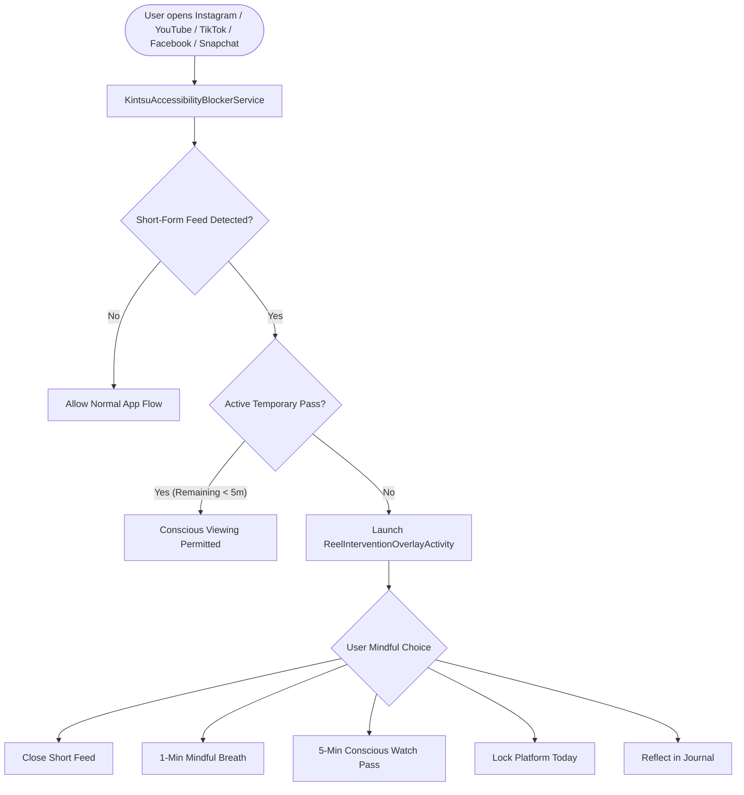
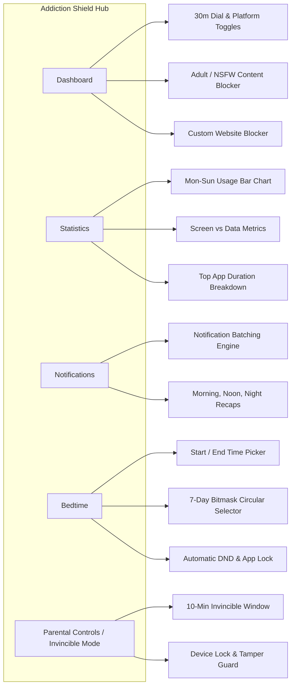
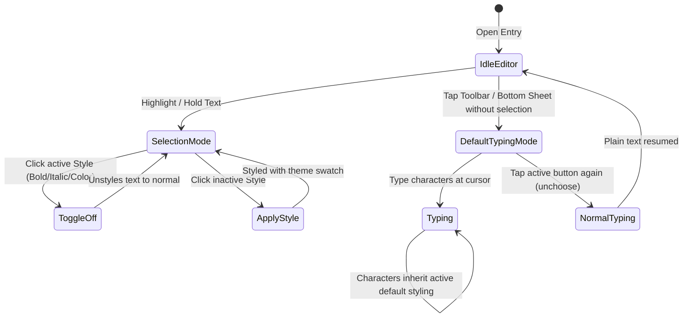

# Kintsu (金継ぎ)

> **Mindful Digital Wellbeing, Habit Sanctuary & Secure Cryptographic Journaling for Android**
> 
> *Treating fractures in human attention not as defects to conceal, but as opportunities for conscious, golden restoration.*

---

## 🌟 Overview

**Kintsu** (inspired by *Kintsugi*, the Japanese art of repairing broken pottery with gold lacquer) is a privacy-first, offline-native Android companion designed to break compulsive digital habits, protect sleep, foster intentional habit loops, and secure personal thoughts behind military-grade local cryptography.

---

## 📸 Key Architecture & Workflows

### 1. Reel & Short-Form Content Interceptor Pipeline



### 2. Addiction Shield 4-Tab Sanctuary



### 3. Rich Journaling Formatting & State Engine



---

## 🚀 Features Implemented So Far

### 1. 🛡️ Addiction Shield (Screenshots 1–6 Parity)
- **Dashboard:**
  - Dynamic Circular Progress Dial ("30M Left from 30m") with umbrella icon and budget editor dialog.
  - Platform toggles with fine-grained controls for Instagram, Snapchat, YouTube, Facebook, and Reddit.
  - Accessibility permission helper banner with one-tap system routing.
  - Adult/NSFW content filter switch with browser heuristics and domain matching.
  - Distracting website blacklist management with real-time domain filtering.
- **Statistics:**
  - Segmented toggle between **Screen** time and **Data** usage.
  - Hero duration card displaying aggregated screen usage (e.g. *7 hours, 9 minutes*).
  - Mon–Sun vertical weekly bar chart with dashed guideline thresholds (10h, 8h, 5h, 3h, 0s).
  - Week navigator (`< Nov 2 - Nov 8 >`) and top used apps breakdown with duration stamps.
- **Notifications:**
  - Batching engine with notification listener service.
  - 2 Hero counter cards tracking live batched notifications and affected apps.
  - "Store all notifications" toggle and history retention dropdown (up to 15 days).
  - Configurable schedule triggers: Morning (8:00 AM), Afternoon (12:00 PM), Evening (8:00 PM).
- **Bedtime Sanctuary:**
  - Interactive Start and End time picker cards.
  - Live calculated duration indicator (e.g., *8 hours* or *0 second*).
  - 7 circular Mon–Sun day pills with bitmask persistence.
  - Automatic Do Not Disturb (DND) integration and system ZEN mode settings shortcut.
  - Distracting apps selector tailored specifically for nighttime routines.
- **Invincible Mode & Parental Controls:**
  - "Activate invincible mode" with customizable 10-minute modification window.
  - App and Group restrictions enforcement once daily quotas are exceeded.
  - Checkboxes to lock shorts timers and bedtime routines against impulsive overrides.
  - Protected access requiring device biometric/credential authentication.
  - Tamper protection with Device Admin activation preventing app uninstallation or force-stop.

### 2. ⚡ Real-Time Short-Form Content Interceptor
- Floating translucent overlay (`ReelInterventionOverlayActivity`) that intercepts reels and short-form feeds across YouTube Shorts, Instagram Reels, TikTok, Snapchat Spotlight, and Facebook Reels.
- 5 Mindful Choices:
  1. **Close Reels Immediately**
  2. **1-Minute Interactive Breathing Bubble**
  3. **5-Minute Conscious Watch Pass** (timed allowance)
  4. **Lock Platform for Rest of Today**
  5. **Reflect in Journal** (prefills mindful prompt)

### 3. ✍️ Precision Typography & Journal Studio
- **Formatting Toggles:** Clicking active styles (Bold, Italic, font size, or color) on selected text removes that style and returns text to normal.
- **Sticky / Default Typing Mode:** Selecting styles from the text menu without an active text selection locks that style as the default for all newly typed characters until unchosen.
- **De-cluttered Top Header:** Back button removed and replaced with a live, formatted Time display (`HH:mm`) and a dedicated Revert/Undo `(<-)` button next to `Save`.
- **Clean List Picker:** Single list icon in the bottom toolbar with a clean popup menu displaying bullet and numbered list icons (zero text labels).
- **Tag Integration:** Tag chip repositioned next to Mood and Weather.
- **Zero Double-Saves:** Robust single-save guard ensuring entries are never duplicated.
- **Multi-Format Media:** Attach photos, videos, quick text memos, and record voice notes with in-line playback.

### 4. 🧘 Home Screen Focus Timer & Dynamic Diurnal Greetings
- **Synchronized Focus Ring:** Live countdown timer right on the Home screen with animated progress ring and seconds ticker.
- **Poetic Diurnal Greetings:** Phase-aware greetings dynamically chosen from probabilistic sets matching time-of-day:
  - *Midnight / Night Owl:* "Night bird, stillness awaits", "Midnight philosopher", "The quiet hours belong to you"
  - *Early Dawn:* "Dawn clarity", "The world wakes in whispers", "First light, fresh beginnings"
  - *Morning / Afternoon / Dusk:* Mindful prompts that evolve throughout the day.
- **Mindful Daily Quotes:** Dynamic rotating quotes banner at the top of the Home screen.

### 5. 🔐 Cryptographic Vault & Personalisation
- **Local Kintsu Cryptographic Vault:** Encrypted backups and notes secured locally on device using AES-256-GCM without remote cloud dependencies.
- **24 Signature Avatars:** Handcrafted geometric and zen avatar selections alongside custom image imports.
- **Theme Studio:** Full theme palettes (Sage Ivory, Wabi-Sabi, Charcoal, Kintsugi Gold, Indigo) conforming to strict contrast standards.

---

## 🛠️ Tech Stack & Architecture

- **Language:** Kotlin 1.9+
- **UI Framework:** Jetpack Compose & Material 3
- **Local Storage:** SQLite via AndroidX Room with Room KSP
- **Preferences:** Jetpack DataStore Preferences
- **System Integration:**
  - `AccessibilityService` (`KintsuAccessibilityBlockerService`) for feed detection
  - `NotificationListenerService` (`KintsuNotificationListenerService`) for notification scheduling
  - AndroidX Glance for interactive Home Screen widgets
  - `DevicePolicyManager` for tamper resistance
- **Architecture:** Unidirectional Data Flow (MVI/MVVM) with StateFlow and Coroutines

---

## 📦 Building and Running

### Prerequisites
- Android Studio Ladybug / Meerkat or later
- Android SDK 34+
- Java JDK 17+
- Gradle 8.9+

### Build Debug APK
```bash
./gradlew assembleDebug
```

### Install to Connected Device
```bash
adb -s <DEVICE_SERIAL> install -r app/build/outputs/apk/debug/app-debug.apk
```

---

## 📜 License
Distributed under the Apache 2.0 License. Designed with mindfulness and crafted for digital clarity.
